# Perancangan dan Simulasi Infrastruktur Jaringan Perusahaan Multi-Lokasi

**Integrasi Kantor Pusat dan Tiga Fasilitas Pabrik Menggunakan Cisco Packet Tracer**

Proyek mandiri berupa simulasi infrastruktur jaringan enterprise multi-lokasi.

| Informasi | Keterangan |
|---|---|
| Kategori | Proyek mandiri |
| Tools | Cisco Packet Tracer |
| Fokus | Network Design, Routing, Switching, Redundancy, Network Services, dan Troubleshooting |
| Jenis implementasi | Simulasi jaringan enterprise |

## 1. Latar Belakang

Perusahaan memiliki satu kantor pusat dan tiga fasilitas pabrik yang membutuhkan konektivitas jaringan untuk mendukung kegiatan operasional dan komunikasi antar lokasi.

## 2. Tujuan Proyek

Membangun simulasi jaringan perusahaan multi-lokasi yang terstruktur, memiliki redundansi, dan dapat terhubung ke internet.

## 3. Topologi Jaringan

Simulasi menghubungkan satu kantor pusat (HQ) dengan tiga fasilitas pabrik melalui jaringan yang terstruktur. Setiap lokasi memiliki segmentasi jaringan masing-masing dan terhubung melalui routing antararea menggunakan OSPFv2.

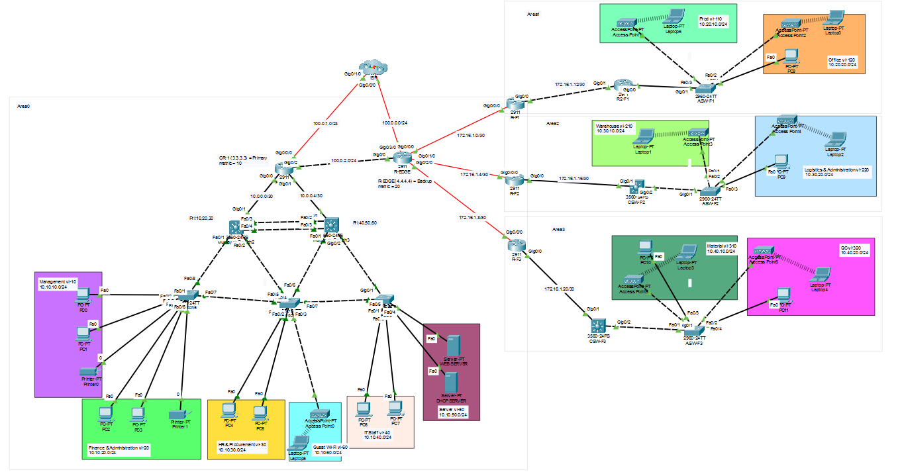

_Gambar 1. Tampilan keseluruhan topologi._

## 4. Routing Antar-Lokasi Menggunakan Multi-Area OSPF

Routing antar lokasi menggunakan Multi-Area OSPF dengan pembagian area sebagai berikut:

| Lokasi/Router | OSPF Area | Router ID |
|---|---:|---:|
| Kantor Pusat | 0 | 3.3.3.3 |
| R-EDGE | 0 | 4.4.4.4 |
| Pabrik 1 | 0, 1 | 5.5.5.5 |
| Pabrik 2 | 0, 2 | 6.6.6.6 |
| Pabrik 3 | 0, 3 | 7.7.7.7 |

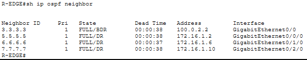

_Gambar 2. Hasil verifikasi OSPF Neighbor pada R-EDGE._

## 5. Segmentasi Jaringan Menggunakan VLAN

Segmentasi jaringan diterapkan menggunakan VLAN untuk memisahkan perangkat berdasarkan fungsi dan kebutuhan operasional di setiap lokasi.

| Lokasi | VLAN ID | Nama VLAN | Network/Prefix |
|---|---:|---|---|
| Kantor Pusat | 10 | Management | `10.10.10.0/24` |
| Kantor Pusat | 20 | Finance & Admin | `10.10.20.0/24` |
| Kantor Pusat | 30 | HR | `10.10.30.0/24` |
| Kantor Pusat | 40 | IT | `10.10.40.0/24` |
| Kantor Pusat | 50 | Server | `10.10.50.0/24` |
| Kantor Pusat | 60 | Guest | `10.10.60.0/24` |
| Pabrik 1 | 110 | Production | `10.20.10.0/24` |
| Pabrik 1 | 120 | Office | `10.20.20.0/24` |
| Pabrik 2 | 210 | Warehouse | `10.30.10.0/24` |
| Pabrik 2 | 220 | Logistic & Admin | `10.30.20.0/24` |
| Pabrik 3 | 310 | Material | `10.40.10.0/24` |
| Pabrik 3 | 320 | QC | `10.40.20.0/24` |

## 6. Implementasi Teknologi Jaringan

Selain routing dan segmentasi jaringan, simulasi ini menerapkan beberapa teknologi pendukung untuk meningkatkan ketersediaan jaringan, mengelola koneksi antarperangkat, dan menyediakan layanan jaringan.

| Teknologi | Implementasi |
|---|---|
| EtherChannel | Menggabungkan beberapa link fisik menjadi satu logical link. |
| HSRP | Menyediakan gateway cadangan untuk meningkatkan redundansi. |
| DHCP | Memberikan alamat IP secara otomatis kepada perangkat klien. |
| NAT Overload | Menerjemahkan alamat IP internal agar dapat mengakses jaringan eksternal. |

### Bukti Implementasi

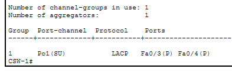

_Gambar 3. EtherChannel pada CORE SWITCH 1._

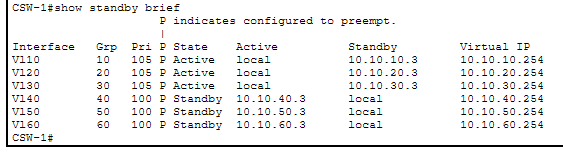

_Gambar 4. HSRP pada CORE SWITCH 1._

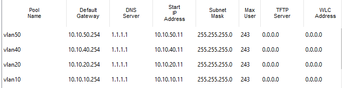

_Gambar 5. DHCP Server._

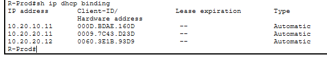

_Gambar 6. DHCP melalui router._

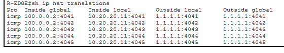

_Gambar 7. NAT Overload traffic dari end device pabrik._

## 7. Pengujian dan Hasil

Pengujian dilakukan untuk memastikan konektivitas antarperangkat, komunikasi antar-lokasi, serta layanan jaringan yang telah dikonfigurasi dapat berjalan sesuai dengan rancangan.

| No. | Skenario Pengujian | Metode | Hasil |
|---:|---|---|---|
| 1 | Konektivitas antar-VLAN di HQ | Ping antarperangkat | Berhasil |
| 2 | Konektivitas HQ ke Pabrik 1 | Ping antarperangkat | Berhasil |
| 3 | Konektivitas HQ ke Pabrik 2 | Ping antarperangkat | Berhasil |
| 4 | Konektivitas HQ ke Pabrik 3 | Ping antarperangkat | Berhasil |
| 5 | Distribusi IP DHCP | DHCP Client | Berhasil |
| 6 | Akses jaringan eksternal | Ping IP tujuan eksternal | Berhasil |
| 7 | Konektivitas Pabrik 3 ke Pabrik 2 | Ping antarperangkat | Berhasil |

### Bukti Pengujian

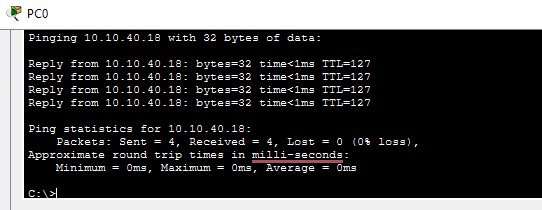

_Gambar 8. Ping VLAN 10 ke VLAN 40._

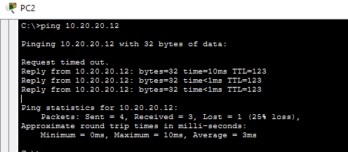

_Gambar 9. Ping PC Kantor Pusat ke PC Pabrik 1._

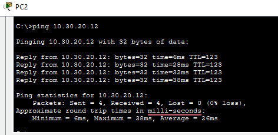

_Gambar 10. Ping PC Kantor Pusat ke PC Pabrik 2._

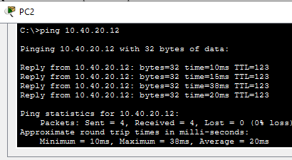

_Gambar 11. Ping PC Kantor Pusat ke PC Pabrik 3._

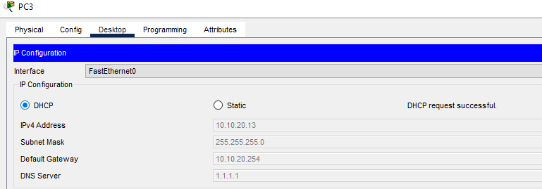

_Gambar 12. Pemberian IP DHCP secara otomatis._

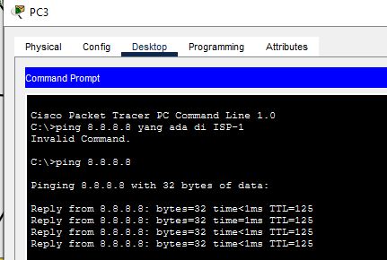

_Gambar 13. Ping IP tujuan yang berada di luar jaringan internal (ISP-1)._

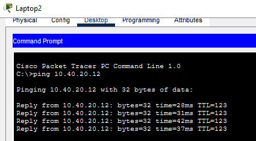

_Gambar 14. Ping PC Pabrik 2 ke PC Pabrik 3._

## 8. Hasil Akhir

Simulasi infrastruktur jaringan perusahaan multi-lokasi berhasil dirancang menggunakan Cisco Packet Tracer dengan menerapkan segmentasi VLAN, Multi-Area OSPF, EtherChannel, HSRP, DHCP, dan NAT. Implementasi ini menunjukkan penerapan konsep routing, switching, redundansi, serta layanan jaringan dalam skenario jaringan enterprise.

## 9. File Simulasi Cisco Packet Tracer

File simulasi jaringan perusahaan multi-lokasi tersedia dalam format Cisco Packet Tracer (`.pkt`).

**Nama File:** `PORTOFOLIO.pkt`

**Lokasi:** `packet-tracer/PORTOFOLIO.pkt`

[Download File Simulasi Cisco Packet Tracer](packet-tracer/PORTOFOLIO.pkt)

File ini dapat diunduh dan dibuka menggunakan aplikasi Cisco Packet Tracer.

## 10. Dokumentasi Pembelajaran

Selain proyek simulasi ini, tersedia dokumentasi pembelajaran yang berisi catatan materi dan proses belajar terkait networking, routing, switching, serta konfigurasi jaringan.

[ Lihat Dokumentasi Pembelajaran (Google Drive) ](https://drive.google.com/drive/folders/1_LPRuOoWryp3BLU60QpmRIiGRSdaTQsI)

## Dokumentasi PDF
Versi portofolio PDF tersedia di [`docs/portfolio.pdf`](docs/portfolio.pdf).
